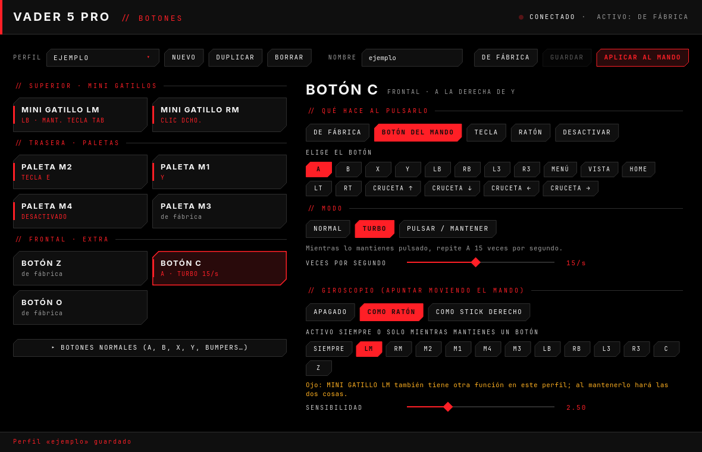

# Vader · Botones

Interfaz gráfica para remapear los botones extra del mando **Flydigi Vader 5 Pro** en Linux, usando [padctl](https://github.com/BANANASJIM/padctl).

> *English: a small GUI for Linux to remap the extra buttons (M1–M4 paddles, C, Z, LM, RM, O), add turbo, tap/hold actions, multi-step macros and gyro aiming on the Flydigi Vader 5 Pro. It writes padctl mapping profiles; nothing is written to the controller.*



## Sobre este proyecto

No soy programador ni experto en Linux. Me compré un Flydigi Vader 5 Pro y me encontré con un problema muy cotidiano: la app oficial para configurar los botones extra solo existe para Windows y Android. Intenté hacerla funcionar en Linux y acabé con el mando desconectándose solo.

En Linux existe [padctl](https://github.com/BANANASJIM/padctl), que hace que el mando funcione de verdad, pero se configura escribiendo archivos y comandos en la terminal, y eso no es lo mío. Así que, con mi suscripción a Claude (el asistente de IA de Anthropic), le fui pidiendo lo que necesitaba: una ventana sencilla para elegir qué hace cada botón, sin tocar la terminal y sin arriesgarme a estropear el mando.

El código lo ha escrito Claude siguiendo mis indicaciones, y yo lo he probado con mi propio mando. Lo comparto por si a alguien más le pasa lo mismo. Si encuentras un fallo o sabes cómo mejorarlo, abre una incidencia o propón cambios: todo lo útil es bienvenido, pero ten en cuenta que no soy un desarrollador y puede que tarde en entender algunas cosas.

Todo el mérito técnico del manejo del mando es de padctl y de su autor. Esta app es solo una interfaz encima.

## Qué hace

- Cambia cualquier botón extra (paletas **M1–M4**, **C**, **Z**, mini gatillos **LM** y **RM**, botón **O**) y también los normales, por:
  - otro botón del mando (A, B, LB, LT, cruceta…),
  - una tecla del teclado,
  - un botón del ratón,
  - o nada (desactivado).
- **Turbo**: repite el botón entre 2 y 30 veces por segundo mientras lo mantienes.
- **Pulsar / mantener**: una acción con toque corto y otra al mantenerlo.
- **Macros**: una secuencia de botones del mando o teclas con un solo botón, eligiendo cuánto se mantiene pulsado cada paso y cuánto se espera entre pasos. Incluye una plantilla de *quit out* para Elden Ring. Cada paso se mantiene pulsado (50 ms por defecto) porque los juegos no detectan las pulsaciones instantáneas.
- **Giroscopio**: apuntar moviendo el mando, como ratón o como stick derecho, siempre o solo mientras mantienes un botón.
- **Perfiles**: crea, duplica, renombra y borra perfiles; aplica uno al momento o vuelve a «de fábrica».

## Cómo funciona (y por qué es seguro)

La app **no habla con el mando**. Solo escribe perfiles de padctl en `~/.config/padctl/mappings/<perfil>.toml`, los valida con `padctl --validate` y, al pulsar **Aplicar al mando**, ejecuta `padctl switch <perfil>`. El remapeo lo hace padctl por software, así que el peor caso es pulsar **De fábrica**.

No se envían comandos internos de Flydigi ni se toca la configuración guardada en el mando (a diferencia de la app oficial de Windows).

Los perfiles son archivos TOML normales: puedes editarlos a mano o usarlos sin la app.

## Requisitos

- Linux con el mando gestionado por **padctl** (probado con `padctl-bin` 0.1.29 del AUR y el receptor 2.4 GHz `37d7:2401`). Sigue su [guía de instalación](https://bananasjim.github.io/padctl/getting-started.html) y comprueba que `padctl status` muestra el mando.
- Python 3.11+ y **PySide6** (Qt 6.5+ con QtQuick).
  - Arch / CachyOS: `sudo pacman -S pyside6`
  - Otras: `pip install --user PySide6`
- Opcional: fuentes **JetBrains Mono** e **Inter** para que se vea como en la captura.

## Instalar

```bash
git clone https://github.com/RyutaToki/vader5-padctl-gui.git
cd vader5-padctl-gui
./instalar.sh
```

Se instala solo para tu usuario (sin sudo) en `~/.local/share/neongrid-vader/`, con el comando `neongrid-vader` y un acceso en el menú: **Vader · Botones**.

Para quitarla: `./desinstalar.sh` (tus perfiles de padctl no se borran).

## Probar sin mando

```bash
./vader-botones --prueba
```

Usa una carpeta de configuración temporal y simula padctl (solo se usa de verdad su validador), así que no cambia nada de tu sistema.

## Botones del Vader 5 Pro

| Botón | Dónde está | De fábrica (vía padctl) |
|---|---|---|
| M1 | paleta trasera, arriba derecha | paleta P1 del Elite |
| M2 | paleta trasera, arriba izquierda | paleta P3 del Elite |
| M3 | paleta trasera, abajo derecha | paleta P2 del Elite |
| M4 | paleta trasera, abajo izquierda | paleta P4 del Elite |
| C | frontal, a la derecha de Y | botón extra 9 |
| Z | frontal, a la izquierda de A | botón extra 10 |
| LM / RM | mini gatillos junto a LB / RB | botones extra 11 / 12 |
| O | botón extra | botón extra 13 |

padctl presenta el mando como un *Xbox Elite Series 2*, por eso Steam ve las paletas.

## Limitaciones

- **Batería**: todavía no se puede mostrar; su formato no se conoce (ver [padctl#92](https://github.com/BANANASJIM/padctl/issues/92)).
- Los atajos de varias teclas a la vez (p. ej. Ctrl+C) aún no los admite padctl.
- Interfaz solo en español por ahora.

## Licencia

[MIT](LICENSE). No está afiliado a Flydigi.
